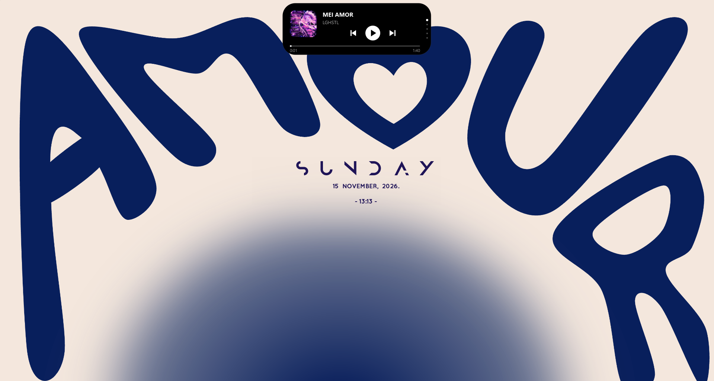
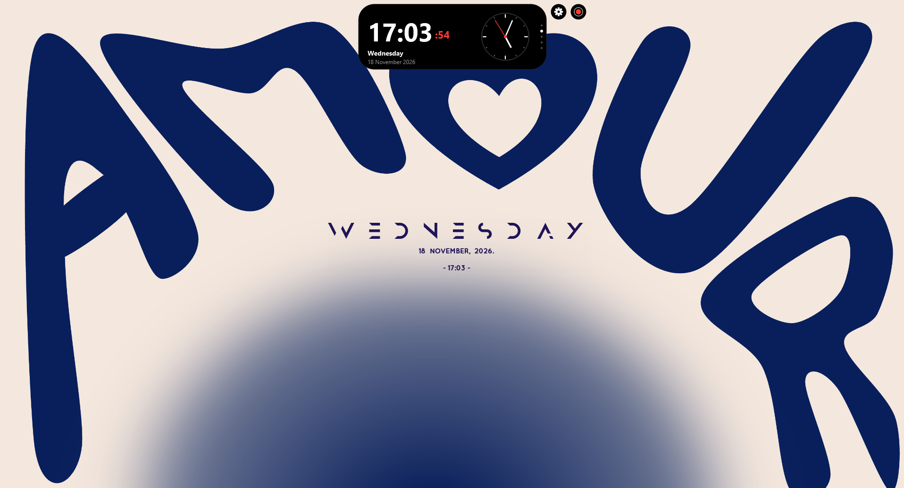
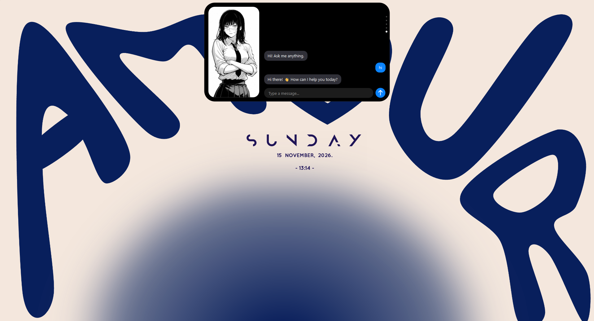

# 🏝️ Dynamic Island for Windows

**Dynamic Island for Windows** is a lightweight, stylish, and interactive desktop widget inspired by Apple's Dynamic Island. Positioned at the top of your screen as an always-on-top overlay, it combines media controls, essential system widgets, and a built-in AI character assistant in one sleek capsule.

---

## ✨ Key Features

* 👀 **Dynamic Idle Capsule:** When collapsed, the widget shrinks into a compact black pill with animated eyes that acts as a non-intrusive desktop companion.
* 🎵 **Media Player Control:** Seamless integration with Spotify and Windows system media players — control playback (play/pause, next/previous track), view album art, and track progress.
* 🕒 **Hybrid Clock:** Features a large digital clock with highlighted seconds alongside a classic analog clock face and the current date.
* 📅 **Interactive Calendar:** A clean monthly grid view with the current day highlighted for quick date checks.
* 🌤️ **Real-Time Weather:** Displays current temperature, weather conditions, wind speed, and a 3-day forecast for your location.
* 🤖 **Built-in AI Companion:** An integrated AI chat assistant featuring a custom anime character avatar, allowing you to ask questions and chat without minimizing your active windows or games.

---

## 📸 Screenshots

| Idle Mode | Music Player |
| :---: | :---: |
|  |  |

| Clock & Time | Calendar |
| :---: | :---: |
|  |  |

| Weather Forecast | AI Assistant |
| :---: | :---: |
|  |  |

*(Note: Create a `screenshots` folder in your repository and upload your images with the corresponding filenames above to display them in this table).*

---

## 📥 Download

You can download the latest compiled `.exe` version for Windows directly from the **[Releases](../../releases/latest)** page:

1. Open the **[Releases](../../releases/latest)** section.
2. Under **Assets**, click on `Dynamiclsland-Setup.exe` to download the file.
3. Run the executable — no installation is required.

> **Note:** Since the app is not signed with a commercial certificate, Windows Defender SmartScreen may show a warning on the first launch. Click **More info** → **Run anyway** to start the widget.

## 🖱️ Controls

* **Hover / Click on Capsule:** Expands the compact pill into the full widget view.
* **Switch Tabs:** Use the navigation dots on the right side of the widget (or scroll with your mouse wheel) to switch between the Media Player, Clock, Calendar, Weather, and AI Chat.
* **Collapse:** Click anywhere outside the widget to return it to the compact idle mode.

---

## 🛠️ Tech Stack

* **Language:** Python 3
* **GUI Framework:** Tkinter / CustomTkinter
* **System Integration:** Windows Media Control API (`winsdk` / `pycaw`)
* **Packaging:** PyInstaller

---

## 📄 License

This project is licensed under the **MIT License**. Feel free to use, modify, and distribute this software with proper attribution.
